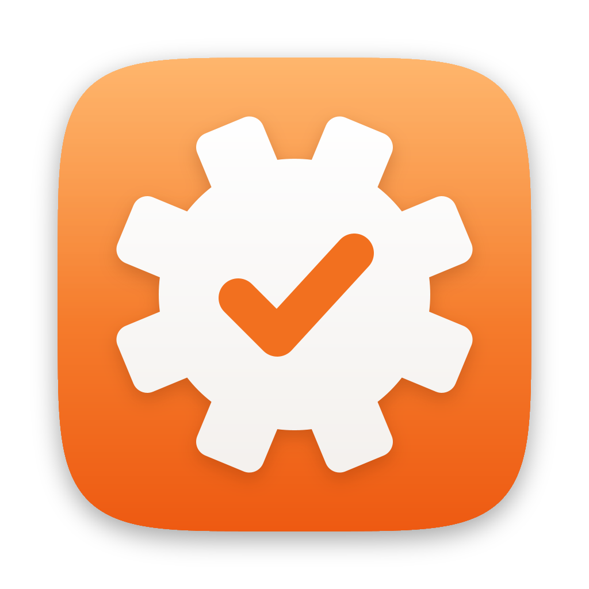
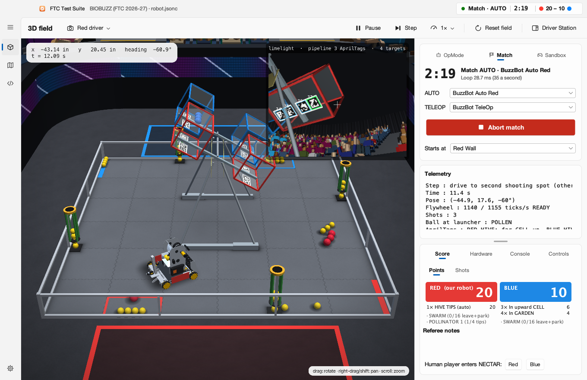
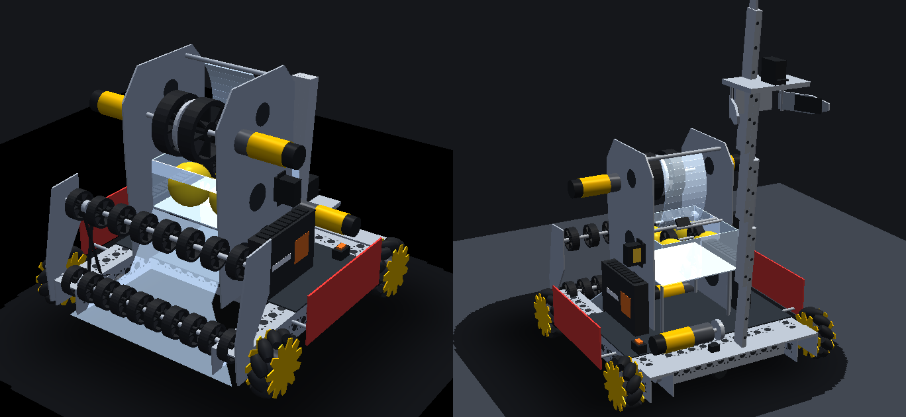
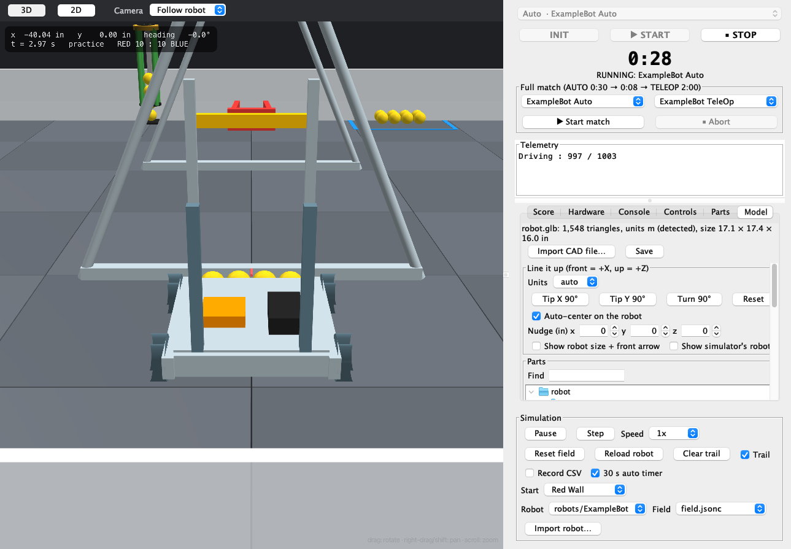
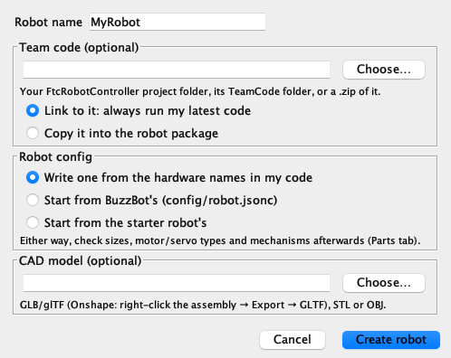

# FTC Test Suite




A desktop simulator for testing FTC robot code before the robot touches the field. Your
competition code runs in it **unmodified**: same packages, same `hardwareMap.get(...)`,
same OpModes. Behind it are a physics model of a mecanum robot, its mechanisms, and this
season's field (**BIOBUZZ**, FTC 2026-27), shown in 3D. You can import your own robot's
code and CAD model, and drive with a PS5 controller.

> **Unofficial.** FTC Test Suite is an independent open-source project (Apache License 2.0, see
> [LICENSE](LICENSE)). It isn't affiliated with, endorsed by or sponsored by *FIRST*. *FIRST* and
> *FTC* are trademarks of their owners. Where the simulator models the game (BIOBUZZ), the rules,
> dimensions and scoring are the authors' reading of FIRST's public documents, and some values are
> estimates (marked in the files): check the Game Manual, and use the simulator to cut down
> physical testing, not to replace it.

<picture>
  <source media="(prefers-color-scheme: dark)" srcset="docs/viewer-dark.png">
  
</picture>

## Quick start

**Double-click `Run Simulator.bat`** in this folder. It needs nothing installed
first and never asks for an administrator: it finds Java 21 on the PC, or downloads it once into
your own profile, and builds the simulator the first time (a few minutes). After that it opens
straight away, and builds again by itself when the simulator's own code changed. Its output goes
to `%LOCALAPPDATA%\FTC Test Suite\Logs\FTC Test Suite.log`. To have **FTC Test Suite** in the
Start menu and on the Desktop, run this once (and again if you move the project folder):

```bat
gradlew installWindowsApp
```

**To give the app to other Windows PCs**, build the zip on Windows:

```bat
gradlew windowsZip
```

This makes `viewer\build\dist\FTC-Test-Suite-Windows.zip` (about 89 MB). Unzip it anywhere and
double-click **FTC Test Suite.exe**: Java 21 is inside, nothing is installed, and no
administrator is needed. If a Windows 11 PC's Smart App Control refuses the `.exe` (it isn't
signed), **Start FTC Test Suite.cmd** in the same folder starts the app with Java's own signed
program instead. The app works in `FTC Sim\Workspaces\App` in the user's folder, fills it
with config, TeamCode, robots and this README the first time, and never overwrites a file that's
there, so a newer zip can be unzipped over an older one. `Read me.txt` in the zip explains it to
whoever gets it.

The window opens on the BIOBUZZ field with **BuzzBot**, the example robot. The pane on the right is your
Driver Station, and its top card has three tabs:

- **OpMode** runs one OpMode. Pick *BuzzBot TeleOp*, press **Init**, then press the same button
  again, now **Start**. Drive with a controller or the keyboard (see [Driving](#driving-teleop)).
  The button becomes **Stop** while the OpMode runs.
- **Match** plays a whole match. Leave *BuzzBot Auto Red* / *BuzzBot TeleOp* selected and press
  **Start match**.
- **Sandbox** is for just driving. Press **Drive**: it stops whatever is running and starts
  the TeleOp straight away, with no AUTO, no match clock and no time limit. **Reset field**
  (in the command bar over the field, Ctrl+Shift+R) works while you drive: the robot goes back to its start
  and the game pieces back in place, and your TeleOp keeps running. Press **Leave sandbox**
  (or Ctrl+.) to stop.

Every button also has a menu command and most have a keyboard shortcut (see
[The window](#the-window)).

**Match sounds:** a full match sounds like one on a real field:

| When | Sound |
|---|---|
| AUTO starts | The charge |
| AUTO ends | The buzzer |
| Transition | "Drivers, pick up your controllers", then "three, two, one" |
| TELEOP starts | The bell |
| 30 seconds left | The factory whistle |
| Match ends | The buzzer |
| Match stopped early | The foghorn |

They follow the simulated match clock, so they stay in time at any speed. Turn them off with
**Match sounds** in **Setup** (the gear at the bottom left, or Ctrl+,). The tones are made by the simulator, not FIRST's
recordings, and the voice is macOS's Samantha.

**3D view:** drag to orbit, right-drag (or Shift-drag) to pan, scroll to zoom. The camera
menu (the camera button at the left of the command bar, or *View ▸ 3D Camera*) has driver-station views for each alliance (looking at the field from a driver's angle,
behind the alliance wall), the audience view, top-down, **Stands** and **Follow robot**.
Choosing a start position moves the camera to that alliance's driver. The 3D view uses a
normal lens (50° corner to corner, like a 50 mm camera lens), so nothing is stretched toward
the edges and near things aren't oversized. Each camera stands back far enough to show its
whole view (the field, or the robot and the floor around it), and fits again when you
resize the window, until you move it yourself. A real driver standing at the wall turns
their head to take in the field; one picture that wide from there would look like a
fisheye, so the driver views look from the same angle but farther back. **2D field** in the
navigation rail (Ctrl+2) switches to the flat field view, which by default is turned to the **driver's view**: your
alliance wall at the bottom. Pick **Top view** from the view menu beside it for the field with
the audience at the bottom.

**Follow robot** (3D camera menu, and the 2D view menu) is a camera that follows the robot. In
3D it's locked behind the robot (no lag or drift) and rides low, about 3 m back. It keeps
following whatever you do with the mouse:
- drag to swing around the robot or look from higher up,
- right-drag (or Shift-drag) to shift the view (never so far the robot leaves it),
- scroll to zoom.

Pick *Follow robot* again to reset it, or another camera to stop following.

Anything that really blocks the robot from the camera (a CELL, a leg, a FLOWER, a wall when
you're low behind it) turns into a wire outline while it's in the way.

In 2D, Follow robot is a close-up that turns with the robot so its front always points up the
screen (scroll to zoom).
With BuzzBot's robot-centric driving that means stick up is up the screen and stick right is
right, wherever the robot faces.

Everything that moves in the simulation moves in the 3D view: wheels, intake roller, flywheel,
the kicker that feeds it, the transfer wheel, the lift and the claw's fingers. Robots with an arm, a
slide without a claw or another spinning motor get a simple stand-in for it. Fast spinners are
drawn turning at a speed the eye can follow. A 6000 rpm flywheel drawn as it is turns more than
a full turn between frames, so it would look still or seem to turn backwards.

The 3D field looks like one at an event:
- foam tiles with interlocking seams,
- clear polycarbonate walls on aluminum rails, like the AndyMark perimeter kit,
- clear CELL panels, so you can see the pieces inside,
- carpet around the field, with the alliance areas taped out where the drivers stand,
- stands all the way round, close as in a gym, with an LED board along the front and a crowd.

The crowd cheers:
- Now and then someone raises their arms.
- When an alliance scores, the fans behind its alliance area and in the corners next to it jump
  with their arms up, and the LED board flashes that alliance's color. The fans on the long sides
  cheer for both.
- Everyone cheers when AUTO and TELEOP start, and when the match ends.
- When it's been quiet for a minute or so, they do the wave.

The driver and audience cameras are fitted tightly to the field, so they show little more than
the LED board. To watch the crowd, pick **Stands**: it looks from high up behind the audience,
with the field in the lower part of the picture and the fans across from it above. You can also
drag the camera lower or zoom out from any view. If you pull the camera back behind the stands,
the sections in the way disappear so you can still see the field.

To turn the stands and crowd off, untick **Crowd and stands** in the camera menu: the field gets the
plain black drape round it instead and nothing in the background moves. The app remembers your
choice the next time it opens.

Robots and game pieces cast soft shadows from the overhead lights. A ball in the air casts a
bigger, fainter shadow that sits off to one side, so you can judge how high a shot is.

To practice with a second driver, tick **Partner robot** in **Setup ▸ General** (see [Practicing with a partner](#practicing-with-a-partner)).

To try your own robot, press **Import robot…** in **Setup ▸ General**, or *File ▸ Import Robot…* (Ctrl+O) (see [Bring your own robot](#bring-your-own-robot)).

**Editing code in the app.** **Code** in the navigation rail (Ctrl+3, and Ctrl+E switches between the
code and the field) shows the source of the code the robot runs. **▶ Save & Run** (Ctrl+R) saves, compiles, reloads the
simulator with the new code and, if ticked, starts the OpMode selected at the top. Compile errors
are marked on their lines; **Run anyway** reloads without the files that don't compile.

## The window

The window is laid out like a Windows 11 app, in Microsoft's Fluent design. It's built to be
light to draw. Panels sit beside the 3D field instead of floating over it, so the app never
redraws anything on top of the live field. The window, the rail and the panes are Mica:
solid surfaces in the theme's colors. Acrylic, the see-through blurred material, is kept for
menus, drop-down lists and the open navigation pane, as in Windows 11. It's drawn from one
snapshot taken as they open, so an open menu costs no more than a plain one.

**Keeping it light.** The field views only draw what changed:
- **3D view:** every frame is copied from the graphics card into the window, so the view
  changes only when something does. The position readout updates up to ten times a second.
  The robot's camera picture is redrawn when the robot or what's in front of it moves, and at
  least once a second. A calm crowd moves four times a second.
- **2D view:** the floor, the robot's path, and the HIVES and FLOWERS are kept on the graphics
  card. Each is redrawn only when it changes, not 60 times a second.
- **Hidden window:** while it's minimized or the app is hidden, nothing is drawn. The
  simulation keeps running.

**Frame rate** (Setup ▸ Appearance): *Efficient* draws the field 30 times a second instead of
60, about half the work. *Automatic*, the default, switches to it when the PC runs on
battery or with battery saver on. Turning the camera with the mouse stays smooth either way.

**Title bar:** the app's name, the season and robot, and the status at the right: what's
running, the clock and the score. Drag it to move the window, or double-click it to maximize.

**Navigation rail** (left): **3D field** (Ctrl+1), **2D field** (Ctrl+2) and **Code** (Ctrl+3), with
**Setup** (Ctrl+,) at the bottom. The ☰ button opens the rail wider with each page's name. Pick a
page, click anywhere else or press Esc to close it again.

**Command bar** (over the page): the page's title, then the camera menu (3D) or view menu
(2D). The 3D menu has the camera positions, *Crowd and stands* and *What the robot's camera
sees*. The 2D menu has driver's view, top view, follow robot and the robot's path. At the right:
**Pause**, **Step** and the speed, **Reset field**, and **Driver Station**, which shows or hides
the pane.

**The Driver Station pane** (right):
- The run card has the **OpMode / Match / Sandbox** tabs, the clock, and one big button that
  always shows the next step (**Init → Start → Stop**, **Start match → Abort match**,
  **Drive → Leave sandbox**). An OpMode's errors show in a red info bar under it.
- **Telemetry** is below the run card. Drag the handle under it to give it more or less room.
- At the bottom are the sections: **Robot 2** (with a partner), **Score** (and its **Shots**
  page), **Hardware**, **Console** and **Controls** (your gamepads, and which keys and buttons
  do what).

Drag the pane's left edge to make it wider.

**Setup** is a page of its own, laid out like Windows Settings with a card per setting. It
has four tabs:
- **General:** the robot and field configs, **Partner robot**, **Import robot…**, the 30 s auto
  timer, match sounds, CSV pose logs and the 2D path. On/off settings are toggle
  switches.
- **Parts**
- **Model**
- **Appearance**

The app remembers the window's size, the pane's width and whether it's showing.

**Menus and shortcuts.** Everything in the window is also in the menu bar
(File, Run, View, Simulation, Help). The most used commands:

| Shortcut | Does |
|---|---|
| Ctrl+I / Ctrl+Enter / Ctrl+. | Init / Start / Stop (Ctrl+. also aborts a match or leaves the sandbox) |
| Ctrl+Shift+M | Start match |
| Ctrl+Shift+D | Drive in the sandbox |
| Ctrl+Shift+R | Reset field |
| Ctrl+P / Ctrl+Shift+P | Pause or resume / step |
| Ctrl+1 / Ctrl+2 / Ctrl+3, Ctrl+E | 3D / 2D / Code; switch between code and field |
| Ctrl+R | Save & Run the code |
| Ctrl+Shift+I | Show or hide the Driver Station |
| Ctrl+, | Setup |
| Ctrl+Shift+L | Show the pages' names in the navigation rail |
| Ctrl+O / F5 | Import robot / reload the robot |

The menus are in the window's title bar: Alt+F, Alt+R, Alt+V, Alt+S and Alt+H open them.

*View ▸ Go To* jumps to any section or Setup page. *Simulation* has the speed, the start
position and (with a partner) which robot the keyboard drives.

### Themes and accessibility

Pick a theme in **Setup ▸ Appearance** or *View ▸ Theme*:
- **Automatic** (the default) follows Windows: Fluent Light or Fluent Dark (Windows 11's own
  colors), as the app mode in Settings ▸ Personalization ▸ Colors says, and High Contrast
  when a contrast theme is on.
- Fluent Light, Fluent Dark
- Gruvbox Dark, Gruvbox Light
- Nord, Dracula
- Solarized Light, Solarized Dark
- One Dark, Monokai Pro
- High Contrast

Every theme gets the same Fluent structure: Mica, a lighter content layer and cards. The code
editor, the 3D and 2D readouts, the scoreboard and the gamepad pictures follow the theme too.

Text stays readable everywhere:
- Text on every surface meets the WCAG AA contrast ratio (4.5:1), in every theme.
- Acrylic checks what's under it as it opens and turns more opaque when it needs to, so its
  text meets the same ratio over anything.
- Button labels and syntax colors are checked the same way, and the focus ring and the
  selection markers stand out at 3:1 or better.
- Tests check every theme against these ratios.

More settings:
- **Transparency effects:** *Automatic* follows Windows' *Transparency effects* setting
  (Settings ▸ Personalization ▸ Colors). *Off* makes menus, drop-down lists and the navigation
  pane solid.
- **Contrast themes:** with one on in Windows (Settings ▸ Accessibility ▸ Contrast themes),
  *Automatic* uses the High Contrast theme: black surfaces, white outlines and a yellow focus
  ring and selection markers.
- **Text size:** *Default*, *Large* or *Larger* (also in *View ▸ Text Size*), for the whole app,
  code editor included.
- **Keyboard:** Tab and Shift-Tab reach every control. Fluent's two-tone focus ring (dark and
  light lines, so it shows on any color) appears once you press Tab, and hides when you click.
  In selector bars (the run tabs, the sections, Setup's tabs), ← / → pick an item. In the
  navigation rail, ↑ / ↓ move between pages and Space opens one.
- **Screen readers:** every control has a name. Icon-only buttons are named by their tooltips, tabs
  and pages report whether they're selected, toggle switches read as on or off, and labels
  are linked to their controls.

## How it's built

| Module | What it does |
|---|---|
| `sdk-shim/` | Stand-in for the FTC SDK (`com.qualcomm.robotcore.*`, `org.firstinspires.ftc.robotcore.*`, REV hub and IMU classes, a few Android helpers). Same names and signatures, compiled at Java 8 like the real SDK. |
| `sim-core/` | Physics ([dyn4j](https://dyn4j.org), a pure-Java engine in the Box2D family), the mecanum and DC motor models, mechanisms, simulated hubs and sensors, game pieces with height, the game rules for each season (`season/biobuzz`), and the OpMode and match runners. No UI code, so everything runs headless too. |
| `viewer/` | The window (Swing, with a JavaFX 3D view), controller support (SDL2 through [Jamepad](https://github.com/libgdx/Jamepad)), CAD model loading, the headless runner, and the `checkShim` tool. |
| `TeamCode/` | Robot code: BuzzBot (`buzzbot/`), the starter-robot examples, and tests. Compiled against `sdk-shim` at Java 8, so it also builds in Android Studio. |
| `config/` | `robot.jsonc` (BuzzBot), its 3D model (`robot.glb`, `robot.model.jsonc`) and `field.jsonc` (BIOBUZZ). `config/examples/` has the simple starter robot and a blank field. `config/parts/` holds your team's parts. |
| `robots/` | Robot packages: a robot's config, its own code, and its CAD model. `robots/ExampleBot` is an example. |
| `tools/` | `BuzzBotCad.java`: builds BuzzBot's 3D model and parts list ([docs/buzzbot-build.md](docs/buzzbot-build.md)) from goBILDA and REV part sizes and weights. |

## BIOBUZZ on the simulated field

Built from the BIOBUZZ Competition Manual (TU05, October 15 2026), section 9 for the field and section 10 for
the scoring. The geometry is measured part by part from FIRST's official field CAD (am-5850
BIOBUZZ, STEP v26-27.2). That includes the field's real size: **141.17 in between the walls**
(six tiles of about 23.5 in), not the nominal 144.

- **HIVE structure** in the center. Each HIVE has two CELLS. The CELL facing up opens
  *outward*, toward the audience or far wall, so you score into it from that side. Each HIVE
  is a rigid body on its pivot. The weight of the pieces in the upward CELL turns it against
  the structure's own weight and the bearing friction. When their torque wins it **tips**
  (20 points): slowly at first, then faster, until the dampers catch it over the last few
  degrees. Where pieces sit matters (a second row sits further out and pulls harder), and a
  ball shot in hard rocks the HIVE. The pieces roll out of the CELL that goes down as soon as
  its floor slopes toward the opening, and the other CELL faces up. Robots drive under the
  HIVES. The frame's feet block them, and so do its legs, which lean in (a taller robot
  meets more of each leg). Balls roll under the legs, and a shot can clip a leg or the top bar.
- **FLOWERS** on the walls take POLLEN and NECTAR through the 21.4 in top opening. Robots pull
  POLLEN (never NECTAR) out of the bottom. The alliance whose NECTAR is on top owns the
  FLOWER. A robot's intake mouth fits around a FLOWER's base.
- **GARDENS**, **LOADING ZONES**, and the AUTO boundary between the red and blue halves.
- **Staging per Figure 10-2.** 40 POLLEN go in the FLOWERS and GARDENS and robot pre-loads. Each
  robot on the field starts with its own 4. Robots that aren't simulated have their pre-loads in
  their LOADING ZONE, as the manual specifies.
  3 NECTAR start in each upward CELL, and 5 per alliance wait with the **human player**. The
  human player brings one in after each of their alliance's tips, and all of them at 1:00 left.
- **Scoring:** all of Table 10-2 (LEAVE, PARK, TIPS, CELL contents, FLOWER ownership,
  bottom-NECTAR bonus, GARDEN), ranking points (SWARM, POLLINATOR 1/2), and the fouls software
  can see: G410 NECTAR in a FLOWER early, G426 early NECTAR, plus warnings for G403/R105.
- **The referee (TU05).** Some rules depend on whether a referee sees a violation as STRATEGIC.
  The simulator calls them the way the manual says a referee likely would. The score breakdown
  lists any cards, and the notes say why:

  | Rule | First time | Likely STRATEGIC (the simulator's call) |
  |---|---|---|
  | G407 more than 4 SCORING ELEMENTS | VERBAL WARNING | a 2nd time in the match (TU05: even with a "keep 4" sorter), or 6+ at once: MAJOR FOUL + YELLOW CARD |
  | G408 opponent's NECTAR | VERBAL WARNING | a 2nd time (TU05: even if a sorter spits it back out): YELLOW CARD |
  | G409 catching what a tipping HIVE spills | VERBAL WARNING | caught twice while stopped under a HIVE: YELLOW CARD |
  | G417 meddling with the HIVE | VERBAL WARNING for a bump | ramming its frame at 1 m/s (40 in/s) or more, or hitting it twice in 5 s: MAJOR FOUL + YELLOW CARD |
  | G421 PIN | MAJOR FOUL after a 3-count, and another every 3 s | |

  Each rule gives at most one YELLOW CARD per match. A second card, in the same match too, is a
  RED CARD (the team is DISQUALIFIED from that match). A PIN is an opponent that's driving but
  can't move, pushed up against a wall or field element. The count pauses while the robots are
  apart, and ends once they've been 2 ft apart for 3 s. Speeds and timings the manual leaves to
  the referee's eye are estimates (`BioBuzzSeason`). BuzzBot's sorter spits out the opponent's
  NECTAR automatically, so under TU05 a referee would likely card BuzzBot if it picks one up twice
  in a match. The fix is a color check before the ball is fully in.
  LEAVE and PARK count for each robot, so SWARM (16 points) takes two robots.
- **Match flow:** AUTO 0:30, an 8 s transition (the TELEOP OpMode is INITed), then TELEOP 2:00.

Values neither the manual nor the CAD gives are estimates in `config/field.jsonc`. Measure
them on real game pieces and update:

| Setting | Default | How to measure |
|---|---|---|
| `tipThresholdG` | 190 g | Count how many POLLEN, resting against the back of the CELL, tip a real HIVE |
| `hiveInertiaKgM2` (or `tipSeconds`) | 0.3 kg·m² (a one-POLLEN-too-many tip takes about 2.1 s; more weight tips it faster) | Film a tip: set `tipSeconds` to the time from when it starts to move until it rests on its other side |
| `pollenMassG`, `nectarMassG` | 25 g, 41 g (AndyMark's listed weights) | Weigh yours |
| `ballVariation` | mass 3 %, diameter 1 %, bounce 8 %, rolling 25 % | Weigh and measure a bag of balls; each ball in the simulator gets its own values |
| `dragCoefficient` | 0.47 (smooth ball) | Adjust until simulated shots land like real ones |

One robot is on the field, or two with **Partner robot** (see
[Practicing with a partner](#practicing-with-a-partner)). Robots nobody drives aren't simulated.

## BuzzBot, the example robot

`config/robot.jsonc` + `TeamCode/.../buzzbot/`. An 18 in mecanum robot with:

- a full-width front **intake** (rollers on a 1150 rpm motor). Balls are pulled in by roller
  friction, one at a time through a 5 in throat: a ball at the very end of the rollers gets
  pushed aside, and two side by side can jam until you spit them out (right trigger off, left
  trigger),
- a 4-ball **hopper** with a CR-servo transfer and a color sensor; it spits out the
  opponent's NECTAR automatically (G408),
- a **flywheel launcher**: two 6000 rpm motors on one shaft, a fixed 55° hood, and a kicker
  servo. It runs under the hub's velocity control with tuned PIDF,
- an angled rear **lift with a claw** that reaches over a FLOWER's base to drop NECTAR in,
- **two dead wheels + IMU** odometry (the dead wheels share drive-motor encoder ports),
- a **Limelight 3A** reading the HIVE AprilTags (see below). Its mount is a placeholder until
  yours is decided: front, 12 in up, tilted up 35°.

**Built from real parts.** BuzzBot is put together from parts you can buy: a goBILDA Strafer
chassis with GripForce wheels, REV Control and Expansion Hubs and Slim Battery, Yellow Jacket
motors, goBILDA servos, a 4-stage Viper-Slide, Gecko wheels and a steel flywheel. Its weight
(25.4 lb), center of gravity, turning inertia, track width, flywheel inertia and lift load in
`robot.jsonc` are worked out from where each part sits and what it weighs.
[docs/buzzbot-build.md](docs/buzzbot-build.md) has the parts list, every weight's source, and
which ones are estimates. The 3D view shows the build itself (`config/robot.glb`): wheels,
rollers, flywheel, kicker, transfer, all four lift stages and the claw move with the
simulation. `tools/BuzzBotCad.java` builds the model and the parts list; run
`java tools/BuzzBotCad.java` after changing it.



The code is plain SDK Java 8, written the way a team would:

| File | What it is |
|---|---|
| `BuzzBot.java` | Hardware map + subsystems; bulk reads once per loop |
| `Localizer.java`, `Drive.java` | Odometry, robot- and field-centric drive, drive-to-pose |
| `Intake.java`, `Launcher.java`, `Lift.java` | Subsystems (the launcher has the distance → speed table) |
| `FieldConstants.java`, `Alliance.java` | BIOBUZZ locations in red coordinates; blue is the 180° rotation |
| `BuzzBotAuto*.java` | Auto from the Wall start: shoot pre-loads to tip the HIVE, collect GARDEN POLLEN, shoot the other CELL, park (picking up the absent partner's POLLEN, when the partner isn't on the field) |
| `BuzzBotTeleOp.java` | Robot-centric drive (`FIELD_CENTRIC = true` for field-centric), hold-to-aim with automatic flywheel speed, lift/claw for FLOWERS |
| `DriverAids.java` | What makes the TeleOp easy to place: a stick curve, a turn cap and a gentle acceleration limit |
| `HiveTags.java` | The HIVE AprilTags through the Limelight: which way each HIVE is tipped, and the bearing and distance to a CELL |
| `BuzzBotLauncherTuner.java` | Re-tune the shooter on a real practice field |

BuzzBot's auto earns about 35 points by itself (LEAVE, PARK, a TIP, CELL contents, GARDEN).

**AprilTags, as FIRST's kickoff describes them.** The 2026-27 kickoff broadcast says the tags
under each CELL are there "to aid lining up to the HIVE and determining which way it's tipped
before launching". BuzzBot's code does both with `HiveTags`:

- **Which way the HIVE is tipped.** Each CELL has four tags on its bottom, 16 on the field:
  - 30–33: the red HIVE's far CELL.
  - 34–37: the red HIVE's audience CELL.
  - 38–41: the blue HIVE's audience CELL.
  - 42–45: the blue HIVE's far CELL.

  A CELL that's up has its tags about 50 in above the tiles; one that's down, about 34 in. So
  any tag the Limelight sees tells which way its HIVE is tipped, even with only one CELL in view.
- **TeleOp target.** The target CELL follows our HIVE: when the tags show it tipped, the target
  becomes the CELL that's up. **Y** still switches it by hand until the next tip.
- **TeleOp aiming.** Holding the right bumper turns the robot until the target CELL's tags are
  on the crosshair. The flywheel speed comes from the tags' distance, so drifted odometry
  doesn't throw it off. With no tags in view, it aims from the odometry pose as before.
- **AUTO.** It aims at the tags too. After its first volley it watches them to confirm the HIVE
  tipped. If it hasn't after 3 s, it fires another ball (up to two more) before going on.
- **Telemetry** shows what the camera knows, e.g. *RED HIVE: audience CELL up* and *aiming by 4
  tags*.

A CELL that's down has its tags facing the pivot, so from its own side they're out of sight.
The robot remembers the last tip it saw.

The tags face down, so the Limelight must look up to read them: from BuzzBot's 45 in shooting
spots a camera tilted up 30–40° sees 2–4 of a CELL's tags, and a level one sees none. The robot
code needs the camera's pose set in the Limelight's web interface. If you move the camera, change
`robot.jsonc` and the Limelight's settings together.

## Driving TeleOp

### With a controller

Plug in a PS4 (DualShock 4), PS5 (DualSense), Xbox or Logitech controller over USB, or pair it
over Bluetooth: on a **PS4** controller hold **PS + Share** until the light bar double-flashes, on a
**PS5** controller hold **PS + Create** until the light flashes, then pick it in Windows' Bluetooth
settings (a PS4 controller shows up as "Wireless Controller"). Rumble works over USB and Bluetooth. The first controller becomes `gamepad1` and the second `gamepad2`. To swap them, do
what you'd do on the Driver Station: **Options + Cross** makes a controller `gamepad1`, **Options + Circle** makes it `gamepad2`.
With a partner robot the second controller drives robot 2 (see [Practicing with a partner](#practicing-with-a-partner)).

| PS4 / PS5 | FTC gamepad field |
|---|---|
| Cross ✕ / Circle ○ / Square □ / Triangle △ | `a` (`cross`) / `b` (`circle`) / `x` (`square`) / `y` (`triangle`) |
| L1 / R1, L2 / R2 | `left_bumper` / `right_bumper`, `left_trigger` / `right_trigger` |
| Sticks, L3 / R3 | `left_stick_x/y`, `right_stick_x/y`, `left_stick_button` / `right_stick_button` |
| Options / Share (PS4) or Create (PS5) / PS / touchpad click | `start` (`options`) / `back` (`share`) / `guide` (`ps`) / `touchpad` |

Stick values follow the SDK (pushing up gives a negative `left_stick_y`). Like the real Driver
Station, the simulator reads the controllers 100 times a second on its own thread and applies
the Driver Station's deadzone for that controller (PS4/PS5 0.05, Logitech F310 and Xbox 0.1):
the stick starts from zero at the edge of the deadzone instead of jumping. Each reading reaches
the robot after the Driver Station-to-robot delay (`hubTiming.gamepadDelayMs` in `robot.jsonc`,
20 ms by default [ESTIMATE]), in simulated time. `gamepad1.type()`
reports the controller like the Driver Station does. When your OpMode calls `gamepad1.rumble(...)`,
`rumbleBlips(...)` or `runRumbleEffect(...)`, the controller rumbles. The **Controls** section shows
both gamepads exactly as your OpMode sees them, including the LED color it set. (The light bar on
a real controller doesn't change color yet.) Controllers work even when the window isn't in front.

BuzzBot's TeleOp uses these features: the light bar shows the alliance color, the controller
buzzes when the shot is lined up, and it gives three blips with 30 s left.

**Stick directions.** BuzzBot's TeleOp drives robot-centric: the sticks always mean the same
thing to the robot, whichever way it faces. Left stick up drives forward, down backward, right
strafes right, left strafes left; right stick right turns right. A test turns the robot to
five headings and checks all four directions plus both turns. If your drivers prefer
field-centric (stick up = away from your alliance wall), set `FIELD_CENTRIC = true` in
`BuzzBotTeleOp.java`.

**Driving feel.** BuzzBot's drivetrain is balanced the way a real 312 rpm mecanum robot is. It
tops out at about 64 in/s, strafes at about 88% of that, turns a full circle in about 1.4 s and
needs about 7% power to start moving. A test (`DriveFeelTest`) keeps it that way. The TeleOp
adds what competition TeleOps use to make that speed easy to place (`DriverAids.java`): a
stick curve, so small movements give fine control while full stick is still full speed;
turning capped at 70%; and speeding up limited to 0 to full in a third of a second, so a jab of
the stick doesn't jerk the robot. Slowing down and stopping are never limited. Tune or turn
them off in `DriverAids`.

### With the keyboard

Keys go to `gamepad1` while an OpMode is in INIT or running. You can use the keyboard and a controller together.
With a partner robot, **Keyboard → Robot 1 / Robot 2** above the field picks which robot's `gamepad1` it is.

| Keys | Gamepad | BuzzBot TeleOp |
|---|---|---|
| W A S D | left stick | drive: W forward, S back, D strafe right, A strafe left (robot-centric) |
| Q / E | right stick X | turn |
| U | left bumper | slow mode |
| O | right bumper | hold to aim at the target CELL |
| K | A | fire one ball |
| I | Y | switch target CELL (starting / other; the AprilTags also switch it when the HIVE tips) |
| L | B | open / close claw |
| C / Z | right / left trigger | intake / spit out |
| ↑ / ↓ | D-pad | lift to FLOWER height / down |
| J | X | (INIT) choose blue alliance |
| R / F, 1 / 2, Enter, Backspace, G | right stick Y, stick buttons, start, back, guide | |

Hold Shift for half-speed sticks. While no OpMode is running you can drag the robot and
scroll over it to rotate it. **Start** (bottom right) picks a start position and alliance.

## Practicing with a partner

Two drivers can practice at once, each with their own robot, like an alliance. Tick
**Partner robot** in **Setup ▸ General**. The simulator opens again with a second robot (the
setting is remembered). By default it's the same robot with the same code, at your alliance's
other start.

- **The Robot 2 section** is the partner's Driver Station: which robot it is (any robot config
  or robot package), its start, its OpMode with the same **Init → Start → Stop** button, its
  telemetry and its gamepads. The run card at the top of the pane stays robot 1's.
- **Starts.** Each robot picks its own start. Picking the start the other robot is on swaps
  them. Pick a start on the other alliance to practice against each other instead: the
  robot then plays and scores for that alliance.
- **Controllers.** The first controller drives robot 1 and the second drives robot 2.
  Driver Station style combos move them:

  | Press | Controller becomes |
  |---|---|
  | Options + Cross (Start + A) | robot 1's `gamepad1` |
  | Options + Circle (Start + B) | robot 1's `gamepad2` |
  | Options + Square (Start + X) | robot 2's `gamepad1` |
  | Options + Triangle (Start + Y) | robot 2's `gamepad2` |

  **Keyboard drives: Robot 1 / Robot 2** (at the bottom of the run card, or *Simulation ▸
  Keyboard Drives*) picks which robot the keyboard drives.
- **Match** has a row for each robot: its AUTO and its TELEOP. Robot 2's AUTO starts as
  *(no AUTO)*, because AUTOs are usually written for one start (BuzzBot's for the Wall start).
  Its TELEOP starts as robot 1's.
- **Sandbox** drives both robots with their TELEOPs and no clock. **Reset field** puts both
  back. **Leave sandbox** stops both.
- **3D view.** Both robots are drawn, with a **1** or a **2** on their side signs. The camera
  menu has **Follow robot 1** and **Follow robot 2**, and the top-left corner shows where each
  robot is.
- **The robots meet.** They push each other, block each other's shots, and their distance
  sensors see each other.
- **Each robot runs its own copy of its code.** Static fields, like a pose an AUTO saves for
  the TeleOp, aren't shared. So each robot's TeleOp starts from its own AUTO.
- **Scoring.** Each robot has its own pre-loads and earns its own LEAVE and PARK. Referee notes
  say which robot broke a rule ("G403 warning: powered movement by Robot 2…").

The 2D view, the browser page, Hardware and Shots show robot 1. When no AUTO ran before
BuzzBot's TeleOp, pick the robot's start during INIT, as on a real robot: **A** = Wall start,
**Y** = Audience start (and **B**/**X** for red/blue). A partner at the Audience start needs **Y**,
or its pose (and so its hold-to-aim) is off.

Tests can use two robots too:

```java
try (SimHarness sim = SimHarness.loadWithPartner()) { // config/robot.jsonc twice
    sim.robot(2).startAt("Blue Wall");                  // an opponent this time
    sim.runMatch(List.of("BuzzBot Auto Red", "BuzzBot Auto Blue"), List.of("BuzzBot TeleOp", "BuzzBot TeleOp"));
}
```

`SimHarness.load(fieldFile, List.of(robotFile1, robotFile2))` loads two different robots.

## Watching from a browser

While the simulator is open, anyone you allow can watch it live in a browser: the field, the
score and match clock, and the robot's stats (speed, battery voltage and current, loop time,
motors, mechanisms, servos, telemetry, recent shots, and charts of the last 30 seconds). The
page is **view only**: nothing on it can start, stop, pause or change anything, and the server
refuses every request that isn't a plain read. The **Whole field / Follow robot** switch above
the field only changes what that browser shows. Follow robot is a close-up that stays on the
robot. With a partner robot, the page shows robot 1.

The page starts when the simulator opens and stops when you close it. The
Console lists its addresses, for example:

```
Watch the simulator in a browser (view only): http://localhost:8766/  or  http://my-pc.tailnet-name.ts.net:8766/  or  http://100.77.243.34:8766/
```

Who can open it is set in `config/web-view.jsonc`:

| `access` | Who can watch |
|---|---|
| `"tailscale"` (default) | This computer and devices on your [Tailscale](https://tailscale.com) tailnet, by MagicDNS name or 100.x address. Requests from the local network are refused. |
| `"local"` | Only this computer. |
| `"network"` | Anyone on the local network too (plain HTTP, so only on a network you trust). |

The page stays on this computer (`"local"`) whatever `access` says, until the
file also has `"allowNetworkOnWindows": true`. The first time a program opens a page to other
devices, Windows Defender Firewall shows a prompt that only an administrator can accept, and the
simulator never asks for an administrator by itself. With that line set, accept Windows' prompt
once.

Change `port` there if 8766 is taken.

## Headless runs and automated tests

```bat
gradlew headless --args="--match --auto 'BuzzBot Auto Red' --teleop 'BuzzBot TeleOp' --snapshot logs/match.png"
```

prints the score breakdown and referee notes for a full match, in about 2 s of real time.
`--opmode NAME` runs a single OpMode instead; `--start 'Blue Wall'` picks the start;
`--driver-view` turns the snapshot to the driver's view.

Tests run real OpModes and check the results (`TeamCode/src/test/...`). In tests and headless
runs, simulated time only moves inside `runFor`, `runMatch`, `init` and `stop`, so the same test
gives the same result every time. A match replayed in the same session plays out exactly like the
first: each reset power-cycles the sensors (their noise starts over) and rebuilds the physics
world.

```java
try (SimHarness sim = SimHarness.load()) {
    sim.startAt("Red Wall").runMatch("BuzzBot Auto Red", null);
    assertEquals(1, ((BioBuzzSnapshot) sim.season()).red().tipsAuto());
}
```

```bat
gradlew test
```

`SoakTest` is a glitch hunt: it drives BuzzBot's TeleOp with random sticks and buttons from
several start positions and fails if anything impossible happens (the robot or a game piece
outside the field, a piece inside the robot, pieces stuck inside each other or hovering in the
air, pieces appearing or vanishing). Point it at your own TeleOp to shake out problems in your
code and robot config the same way.

## Tuning the shooter

```bat
gradlew :TeamCode:launcherSweep
```

test-shoots BuzzBot at the HIVE from 30-57 in and three angles, and prints which flywheel
speeds score. That's how `Launcher.SPEED_TABLE` was made. The **Shots** page of the **Score** section plots
each shot's height against distance with the CELL opening marked. `gradlew :TeamCode:autoTrace`
prints an autonomous step by step (true pose, odometry, hopper, telemetry).

## Editing robot code in the app

Press **Code** (next to **3D | 2D** at the top, or Ctrl+E) to see every source file the robot runs:
the project's `TeamCode`, a robot package's `code/` folder, or the team code it links to (and
the partner robot's code if it's different).

- Edit with syntax highlighting, line numbers, bracket matching and code folding. Ctrl+F finds,
  Ctrl+S saves, Ctrl+N makes a new OpMode or class from a template, and **Delete** moves a file to the Recycle Bin.
- **▶ Save & Run** (Ctrl+R, from anywhere in the window) saves every file and compiles. If there's
  an error, it stops: the line is marked, and the list under the editor jumps to each error.
  Otherwise the simulator reloads with the new code (about half a second) and, with
  **and start the OpMode** ticked, INITs and STARTs the OpMode selected in the Driver Station,
  so you can watch it right away. **Run anyway** reloads without the files that don't compile.
- Edits go straight into your source files, the same files Android Studio uses. Files changed
  in another editor are reloaded when you come back. Nothing is lost when the window closes,
  because unsaved changes are saved then.
- While the Code view is showing, the keyboard types code instead of driving the robot.

The simulator compiles `TeamCode` itself (only what changed, into `build/sim-teamcode`), so the
code you see is the code that runs, with no Gradle build in between.

## Bring your own robot



Press **Import robot…** (in **Setup ▸ General**, or *File ▸ Import Robot…*, Ctrl+O):



1. **Team code.** Pick your FtcRobotController project folder (or just its `TeamCode` folder,
   or a `.zip` of it). *Link* keeps using the code where it is, so the simulator always runs
   your latest version; *Copy* takes a snapshot into the robot package. Only `TeamCode` is
   compiled, never the SDK's `FtcRobotController` module.
2. **Robot config.** The simulator can write a first `robot.jsonc` from the `hardwareMap` calls in
   your code. It finds every device name, spots the four drive motors by their names
   (`leftFront`, `fl`, `front_left_motor`...), and puts placeholder parts everywhere. Open it
   and fix what's marked `TODO`: size, mass, wheel spacing, motor and servo types, and lifts or
   arms (add a `mechanism` for each). Or start from BuzzBot's or the starter robot's config instead.
3. **CAD model** (optional). See [CAD models](#cad-models) below.

The robot then opens. Its code is compiled with the JDK's compiler (Java 8 language, like the FTC SDK; newer library methods that Android backports, such as `List.of`, are allowed),
and the OpMode list shows **only that robot's OpModes**. Edit your code and press **▶ Save & Run** in the **Code** view (or **Reload** in **Setup ▸ General**, F5)
to recompile; it takes a second or two, and unchanged code isn't recompiled.

**When things don't line up**, the Console says so:

- `CONFIG CHECK:` lines list device names your code asks for that aren't in `robot.jsonc`.
  Only names written as string literals are found.
- Files that don't compile in the simulator are **left out**, and the rest still runs. A popup
  lists the files and the reason. Common causes:
  - a library the simulator doesn't have. Put its `.jar` files in the robot's `libs/` folder.
  - an SDK class the shim doesn't cover yet. Add it to `sdk-shim/` with the same package,
    name and methods as the real SDK.
- **FTC Dashboard** code works: `FtcDashboard`, `@Config`, `TelemetryPacket`, `Canvas` and
  `MultipleTelemetry` are simulated. Data your code sends to the dashboard appears under the
  telemetry, and what it draws on the dashboard's field (Road Runner draws the robot's
  estimated pose and path there) is drawn on the simulator's field. In 3D it lies on the tiles,
  under the robots. The dashboard web page and
  live `@Config` editing aren't simulated. Pedro Pathing's **Panels** works the same way.

### Robot packages

A robot package is a folder in `robots/`:

| File | What it is |
|---|---|
| `robot.jsonc` | The simulated robot. Device names must match the names in your code. |
| `code/` | Your Java sources, or a `"code": { "dirs": ["path/to/your/project"] }` section in `robot.jsonc` to link them |
| `libs/*.jar` | Extra libraries your code needs (optional) |
| `robot.glb` + `robot.model.jsonc` | The CAD model, and how it sits on the robot (optional) |
| `parts/*.jsonc` | Parts only this robot uses (optional) |

`robots/ExampleBot` is a complete example: its own TeleOp and Auto, a Viper-Slide lift with a
claw, and a CAD model whose wheels, lift stages and claw fingers move. Choose it in the **Robot**
menu, or run it headless:

```bat
gradlew headless --args="--robot robots/ExampleBot/robot.jsonc --opmode 'ExampleBot Auto' --start 'Red Wall'"
```

Packages work in tests too: `SimHarness.load(Path.of("robots/MyRobot/robot.jsonc"), Path.of("config/field.jsonc"))`
compiles the package's code and uses its OpModes.

You can also keep developing in this project's `TeamCode/` module as before. A robot config in
`config/` uses the TeamCode OpModes. Libraries for TeamCode go in `TeamCode/build.gradle`
(`.aar`s in the `aar` configuration; FTCLib is set up as an example); run `gradlew checkShim`
after adding one.

### Odometry, Road Runner and Pedro Pathing

Your localizer code runs unmodified against simulated devices that behave like the real ones:

- **goBILDA Pinpoint** (`GoBildaPinpointDriver`, SDK 12.0). It fuses its two pods and its own
  IMU like the real one: pose in mm and radians of the tracking point your pod offsets describe,
  field-frame velocities, a heading that counts whole turns, `resetPosAndIMU()` and
  `recalibrateIMU()` measuring the gyro's zero for 0.25 s (status `CALIBRATING`; if the robot
  moves meanwhile, the heading drifts afterwards), and the factory yaw scalar. V1 and V2
  firmware (bulk-read scope, CRC, quaternion). The driver talks to it register by register, so
  a copy of goBILDA's own driver in your TeamCode works too, and every call costs its real I2C
  time. Add it to `robot.jsonc`:

  ```jsonc
  "pinpoints": [
    { "name": "pinpoint",
      "xPod": { "type": "goBILDA-4-Bar-Odometry-Pod", "xIn": 0, "yIn": 3.5 },     // tracks forward
      "yPod": { "type": "goBILDA-4-Bar-Odometry-Pod", "xIn": -2.0, "yIn": 0 } }   // tracks sideways
  ]
  ```

  Optional: `"version": "V1"`, `"yawScaleError"`, `"driftDegPerMin"`, `"noiseDeg"`, `"ideal": true`.
- **SparkFun OTOS** (`SparkFunOTOS`). Distances read 3% short until you set the linear scalar
  (SparkFun: "3-5% out of the box"), the gyro over- or under-reads turns until you set the
  angular scalar, `calibrateImu()` pauses tracking, the pose is the robot's center only if
  `setOffset()` says where the sensor sits, and it only sees the foam at 10 ± 1 mm: further off
  it under-reads, beyond ± 3 mm (or above 2.5 m/s) it loses the tiles and `warnOpticalTracking`
  is set. `"otos": [ { "name": "sensor_otos", "xIn": 0, "yIn": 0, "mountHeadingDeg": 90, "heightMm": 10 } ]`,
  optional `"linearScaleError"`, `"angularScaleError"`, `"driftDegPerMin"`, `"ideal": true`.
- **Dead wheels** (`odometryPods`, and the Pinpoint's pods) aren't perfect either: each rolls
  on a diameter a few tenths of a percent off nominal and is mounted about 0.5° off its axis
  (drawn once per pod, so the same every run), skips a little at tile seams at speed, under-reads
  while braking hard, and jolts in a collision. Tuning finds the first two, as on a real robot.
  `"diameterScale"` and `"mountAngleDeg"` set measured values; `"ideal": true` turns it all off.
- **Encoder velocity** comes from the hub as on a real robot: ticks counted over the last 50 ms,
  times 20 (always a multiple of 20 ticks/s, about 25 ms old), wrapping at 32767.

- **OctoQuad** (Digital Chicken Labs, FTC Edition MK2, firmware 3.1), through the SDK's
  `OctoQuad` interface. Plug dead wheels into its channels in `robot.jsonc`:

  ```jsonc
  "octoquads": [ { "name": "octoquad", "channels": [
    { "port": 0, "type": "goBILDA-4-Bar-Odometry-Pod", "xIn": 0,  "yIn": 3.5, "direction": "forward" },
    { "port": 1, "type": "goBILDA-4-Bar-Odometry-Pod", "xIn": -2, "yIn": 0,   "direction": "lateral" } ] } ]
  ```

  Channels count with their directions. A velocity is the change in counts over the channel's
  sample interval (50 ms unless set), as on the real board. Reads cost I2C time. In AUTO
  caching, reading a channel a second time refreshes the whole block.

  The localizer follows Digital Chicken Labs' quickstart guide:
  - The X and Y ports, counts per mm and TCP offset you set take effect at
    `resetLocalizerAndCalibrateIMU()`. The IMU then warms up and calibrates (about 1 s), with the
    status going `WARMING_UP_IMU`, `CALIBRATING_IMU`, then `RUNNING`.
  - Directions: +X is out the robot's front, +Y to its left, counter-clockwise positive.
  - The TCP offset moves the tracked point from where the wheels' lines cross to wherever you
    say, usually the robot's center.
  - Its IMU over-reads every turn by about 1% until you set the heading scalar.
  - Turning while it calibrates leaves a drift.

  Optional: `"imuScaleError"`, `"driftDegPerMin"`, `"ideal": true`.

The window shows what each Pinpoint, OTOS and OctoQuad reports next to the true pose (in 3D
under the pose at the top left, in 2D at the bottom left): the difference is your localization
error.

**Road Runner 1.0** and **Pedro Pathing 3** are built in (same Maven coordinates as their
quickstarts), so robot packages can use them without jars in `libs/`. Their own timing
(trajectories, PID, timers) runs on simulated time, so they're right when the simulator is
paused, sped up, or running a test as fast as possible.

- `robots/RoadRunnerQuickstart` is the Road Runner quickstart's TeamCode, unmodified, on a
  Strafer-style robot with a Pinpoint. Its tuning OpModes (registered by `TuningOpModes` with
  `@OpModeRegistrar`, as on a robot) all appear. Tune it as on a real robot
  ([rr.brott.dev/docs/v1-0/tuning](https://rr.brott.dev/docs/v1-0/tuning)); the ramp loggers save
  to `sdcard/RoadRunner/tuning/` in this project. `RoadRunnerTest` shows the result: once tuned,
  the quickstart's own `SplineTest` ends within half an inch of the path's end.
- `robots/PedroQuickstart` is Pedro Pathing's current Quickstart, unmodified. Fill in
  `Constants.create()` (pedropathing.com, Tuning / Constants); `PedroTest` follows a line and a
  curve with the docs' example constants to within an inch.
- Tuning OpModes that ask you to **push the robot** (Road Runner's ForwardPushTest, Pedro's
  localizer tuners): while an OpMode runs, drag the robot on the field. The point you grab is
  pulled toward the mouse like a hand pushing it (grab a corner to turn it); the wheels, pods
  and gyro all see the motion.
- **Wait in INIT** before pressing START, as on the robot: the Pinpoint zeroes its gyro for 0.25 s
  when a localizer resets it.
- Pedro Pathing 2.x: put its jars (`ftc`, `core`, `telemetry`) in the robot's `libs/`; they
  replace the built-in Pedro 3 for that robot.
- **Ivy**, Pedro's command library (`com.pedropathing.ivy:pedro:1.1.1`), is built in too:
  - `Scheduler`, `Command.build()`, `sequential` / `parallel` / `race`, `waitMs`, and
    `PedroCommands.follow`.
  - Its waits run on simulated time.
  - `IvyTest` runs an auto written the usual way: schedule in `start()`, then
    `follower.update()` and `Scheduler.execute()` in `loop()`.

### Cameras: Limelight 3A and webcams

Add cameras to `robot.jsonc`. Your Limelight and webcam mounts aren't decided yet, so both start
at a placeholder: the front of the robot, looking straight ahead, the Limelight 10 in up and
the webcam 8 in up. Once you know where they go, set `xIn`, `yIn`, `zIn` (forward, left and up
from the floor, measured from the robot's center), `headingDeg` (turned left), `tiltUpDeg` and
`rollDeg`.

```jsonc
"limelights": [ { "name": "limelight", "zIn": 10, "tiltUpDeg": 0 } ],
"webcams":    [ { "name": "Webcam 1", "model": "C920", "zIn": 8, "tiltUpDeg": 0 } ]
```

**Limelight 3A** (`hardwareMap.get(Limelight3A.class, "limelight")`). The pipeline slots follow
TRC's BIOBUZZ Limelight guide: 0 yellow (POLLEN), 1 red, 2 blue, 3 AprilTags (36h11). Change
them with `"pipelines": [ { "index": 0, "type": "color", "target": "pollen", "erode": 1,
"dilate": 2 }, … ]`.

- Color pipelines run at 90 frames a second and the AprilTag pipeline at 50.
- Each result is ready a frame plus its processing time after the picture is taken, and the SDK
  polls for it 100 times a second.
- A pipeline switch takes effect a frame or two later, and each result says which pipeline made
  it.
- You get `tx`/`ty`/`ta` and the color and fiducial results. Botpose comes as MegaTag 1, and as
  MegaTag 2 once you call `updateRobotOrientation()`. `uploadFieldmap()` is supported.
- Game pieces that touch in the picture are one blob, and so are ones closer than the
  pipeline's dilate minus erode.

**Webcams** (`hardwareMap.get(WebcamName.class, "Webcam 1")` and a `VisionPortal`).

- **Models:** `C920`, `C270`, `C310`, `goBILDA` (3122-0003-0001), `LifeCam` (HD-3000), or
  `generic` (an uncalibrated webcam). The resolutions and lens calibrations are the SDK's own.
- **The SDK's processors work:**
  - `AprilTagProcessor`: single tags, BIOBUZZ's CELL clusters (`percentClusterFound`),
    `ftcPose`, `robotPose` from `setCameraPose()`, `setDecimation()`, `setLensIntrinsics()`, and
    the SDK's 578 px guess (with its warning) when your camera has no calibration at that size.
  - `ColorBlobLocatorProcessor`, with the region of interest, blur, erode/dilate, filters, sorts
    and the blob measures.
  - `PredominantColorProcessor`, with the SDK's swatch rules.
  - The samples' AprilTag poses match the SDK's math: rotations and angles come out the same as
    the real SDK's to the last digit.
- **Timing:** about 1.7 s from `build()` to `STREAMING`. The frame rate comes from the
  resolution and format and from how long the processors take. For example, YUY2 1280x720 runs
  about 10 frames a second; MJPEG 1280x720 runs 30, which the AprilTag processor brings down to
  about 17. Detections show up when processing ends, so they lag a moving robot.
- **Camera controls:** exposure, gain, focus, white balance and pan/tilt/zoom.
  - Exposure and gain change the picture. With auto exposure (about 15 ms), turning smears tags
    until they can't be read. The samples' `setManualExposure(6, 250)` fixes that.
  - Too short an exposure with no gain is too dark to decode.
- **The SDK's mistakes fail the same way:**
  - `stopStreaming()` while the camera is still opening.
  - Two portals with the default LiveView.
  - A processor added to two portals.
  - A resolution the camera doesn't have.
  - Camera controls before `STREAMING`.
  - Two portals on one webcam.
- **Housekeeping:** the camera closes when the OpMode stops. `saveNextFrameRaw("name")` saves the
  simulated picture to `sdcard/VisionPortal-name.png`.

What the cameras see:

- Game pieces, as shaded balls.
- Other robots, as boxes with bumpers in their alliance color. Those are red or blue blobs too, as
  on a real field.
- The HIVE frame's feet, which hide what's behind them.
- The AprilTags under the CELLs.
- The gray tiles, the field walls and the dark venue behind everything.

To see what the robot's first camera sees, check **Camera view** in the 3D view.

Worth knowing for BIOBUZZ:

- **The tags are hard to see from the floor.** They're under the CELLs, about 4 ft up and facing
  down, so a level or down-tilted camera can't read them. Tilted up 45°, a camera reads them from
  50 in away.
- **Tag poses move when the HIVE tips.** The CELLs tip with the HIVE, so the SDK's BIOBUZZ
  clusters have no field position: a cluster's `robotPose` is relative to the CELL. A Limelight
  field-map pose is wrong after a tip.
- **The biggest blob can be a FLOWER.** From far away, a FLOWER's four stacked POLLEN make a
  bigger blob than one ball, so "chase the largest blob" (as in TRC's guide) drives to the
  FLOWER.
- **Limelight camera-space angles are shuffled.** The SDK reads them in a different order than
  the Limelight writes them, and the simulator copies that.

### CAD models

The 3D view can show your robot's CAD instead of the generated stand-in. Formats:

| Format | Notes |
|---|---|
| **GLB / glTF** (best) | Keeps part names, the assembly tree and colors. In Onshape, right-click the assembly tab → *Export* → *GLTF*. |
| **OBJ** | Keeps named groups and `.mtl` colors. |
| **STL** | One solid piece, so nothing can move. |
| STEP | Not supported. Import it into Onshape and export GLTF (or convert it with FreeCAD or Blender). |

Import a model from the import dialog, or later from **Setup ▸ Model** (**Import CAD file…**).
Then, on the **Model** page:

1. **Line it up.** Turn on *Show robot size + front arrow*. That shows a box the size set in
   `robot.jsonc` and an arrow at the robot's front. Use *Tip X/Y 90°* until the model is
   upright, and *Turn 90°* until its front faces the arrow. *Auto-center* puts it in the
   middle of the robot on the floor. Units are detected (glTF is meters; STL/OBJ in mm or
   inches are guessed from the size). Set them by hand if the size looks wrong.
2. **Make parts move.** Click a part in the 3D view (or find it in the *Parts* list). Under *With*,
   choose the mechanism, servo, motor or drive wheel that moves it, plus the motion
   (*translate* or *rotate*) and the axis in robot coordinates (x forward, y left, z up).
   *Scale* covers parts that move a fraction as far: 0.5 for the middle stage of a two-stage
   slide, 0.08 for a claw finger that turns 24° over the servo's 300°. *Zero* is the device
   value the CAD is drawn at. Drag *Try it* to check the motion without running anything.
   Parts inside a moving part move with it.
3. **Save.** The settings go to `<robot>.model.jsonc` next to the robot config. That file is
   meant to be read and edited by hand too.

Wheels spin with their drive motors' encoders. Moving parts only move in the picture: the
physics still uses the mechanisms in `robot.jsonc`. Parts named `Alliance sign…` take the
robot's alliance color during a match, and the balls in a hopper are drawn over the model.
BuzzBot's own model (`config/robot.model.jsonc`) is a worked example of every kind of binding.

## Parts catalog

Instead of typing in spec-sheet numbers, a device in `robot.jsonc` can name a part:

```jsonc
"drivetrain": { "wheel": "goBILDA-GripForce-104mm-mecanum", ... },
"motors":     [ { "name": "lift", "type": "goBILDA-5203-435" } ],
"mechanisms": [ { "name": "lift", "type": "slide", "motors": ["lift"], "kit": "goBILDA-Viper-4stage-336mm" } ],
"servos":     [ { "name": "claw", "type": "goBILDA-2000-25-3" } ],
"crServos":   [ { "name": "spinner", "type": "goBILDA-2000-25-2" } ],   // dual-mode servo in continuous mode
"odometryPods": [ { "name": "par", "type": "goBILDA-4-Bar-Odometry-Pod", "direction": "forward" } ],
"distanceSensors": [ { "name": "front", "type": "REV-2m-Distance-Sensor", "xIn": 9 } ]
```

The built-in catalog (`sim-core/src/main/resources/parts/catalog.jsonc`) covers:

- goBILDA Yellow Jacket and REV HD Hex / Core Hex motors
- goBILDA 2000-series servos (25-2, 25-3, 25-4), the REV Smart Robot Servo, and the Axon MAX MK2
- GripForce mecanum wheels, Viper-Slide kits, odometry pods and REV sensors

Servo speeds are adjusted to the robot's `servoVolts`: 5 V on a hub servo port, or 6 V with a
Servo Power Module. Anything you write next to the part overrides the part's value. **Setup ▸ Parts**
lists the catalog and the parts your robot uses, and **Copy snippet** gives you the config lines.

Add your own parts, or measured versions of built-in ones (same `id`), in `config/parts/*.jsonc`.
**Add your own parts…** on the Parts page creates a template.

Two values are estimates: the Axon's range (it's programmable up to 355°, so set `rangeDeg` to yours)
and the REV Smart Robot Servo's speed below 6 V.

## Calibration

Settings that can't be right (a zero wheel diameter, a negative mass, a servo with no range,
a mechanism driven by a drive motor...) are reported when the config loads, with the allowed range.

### Calibrating the simulator to your robot

The physics constants in `robot.jsonc` start as good estimates. Calibration measures your
robot instead: it runs a few test OpModes on the real robot, then fits the simulator until it
reproduces what the real sensors saw. About 30 minutes on a practice field.

1. **Describe the robot in `robot.jsonc`**: weigh it (`massLbs`), and check its size, wheel
   diameter, drive motor types and gear ratio, mechanisms and their motors. Calibration fits
   the things that can't be measured with a ruler or a scale, so these must be right.
2. **Copy the calibration OpModes to the robot's code**: the
   `TeamCode/src/main/java/org/firstinspires/ftc/teamcode/calibration/` folder goes into your
   FtcRobotController project. Edit `CalibrationConfig.java` there: motor and IMU names, which
   motors your drive code reverses, which motor ports have dead wheels on them, wheel size,
   and the mechanism to test. Deploy it.
3. **Run them on the field tiles**, with a charged battery:
   - **Calibrate IMU**: one minute standing still. Don't touch the robot or the field.
   - **Calibrate Drive**: about 45 s. It needs `MAX_TRAVEL_IN` (36 in) clear in front of and to
     the left of the robot, and returns to its start after every move.
   - **Calibrate Mechanism**: about 15 s per mechanism. Set `MECHANISM_MOTORS` (and
     `MECHANISM_SPINS`, `MECHANISM_TRAVEL_TICKS` for a lift or arm) and redeploy for each one.
   - **Calibrate Turn**: about 2 minutes (set `TURN_HEADING` to `"pinpoint"` or `"otos"` to
     measure that sensor's heading instead of the hub IMU's). Line one side of the robot up exactly with a tile
     seam (or a strip of tape) and press START. It spins 10 turns counter-clockwise by its
     own heading and stops near where it started. Line it back up with the seam exactly as it
     started, with the right stick or by hand (the wheels are let go while the stick is
     centred), and press A. Then the same clockwise. This measures how much the heading
     sensor over- or under-reads every turn, which only the field itself can show. Take your
     time lining up: 1° of misalignment is 0.03% of 10 turns.
4. **Copy the logs to the computer**: they're in `/sdcard/FIRST/calibration/` on the Control Hub.
   Use Android Studio's Device Explorer, or `adb pull /sdcard/FIRST/calibration logs/`.
5. **Fit the simulator**:
   ```bat
   gradlew calibrate --args="logs/calibration/imu-....csv logs/calibration/turn-....csv logs/calibration/drive-....csv logs/calibration/mechanism-....csv"
   ```
   It prints, for each log, the real robot's numbers next to the simulator's before and after
   (top speeds, turn rate, lowest battery voltage, average mismatch), and the values it found:
   the drive motors' real free speed and torque, gearbox friction, wheel grip, roller drag, how
   hard the robot is to turn (`yawInertiaKgM2`), battery resistance, each mechanism's inertia or
   mass and friction, the IMU's drift and jitter, and the turn scale error of the IMU
   (`imu.scaleError`), Pinpoint (`yawScaleError`, plus the `setYawScalar()` that would cancel it)
   or OTOS (`angularScaleError`, plus the `setAngularScalar()` to use), from both directions
   averaged, which cancels drift. It writes everything to
   `config/robot.calibrated.jsonc`; `robot.jsonc` isn't changed.
6. **Use it**: copy the values into `robot.jsonc`, or start the simulator with
   `gradlew run --args="--robot config/robot.calibrated.jsonc"`.

After calibrating, the average wheel-speed mismatch should be a few percent or less. A line
starting with `CHECK` means a value ended at the edge of what's plausible: usually something in
`robot.jsonc` doesn't match the robot (weight, wheel size, motor type, or a reversed motor).
`CalibrationTest` shows the method works: a stand-in robot with different physics runs the
OpModes in the simulator, and the fit finds its values again (drive motor speed, torque,
friction, grip, roller drag, turning inertia and battery resistance within a few percent; the
IMU's scale error to 0.05%, with a simulated driver lining the robot up after each spin).

Values marked `[CALIBRATE]` or `[ESTIMATE]` that calibration doesn't cover (the center of
gravity height) come from measuring the robot directly; the comments next to them say how.

Two more settings make the simulator as hard on your code as the real robot:

- **Loop time.** Every hardware call waits for the hub, as on a real robot: a motor write or
  encoder read (or one bulk read) takes about 2 ms on the Control Hub and 3 ms on an Expansion
  Hub, and an I2C read (IMU, color, distance sensor) about 3 ms. Writing the value the hub
  already has (the same power again) is free, as in the SDK. The OpMode's average loop time is
  shown under the match timer (and printed by `headless`); BuzzBot's TeleOp runs at about
  22 ms. Time your real robot's loop (an `ElapsedTime` per loop in telemetry) and set
  `"hubTiming": { "controlHubCommandMs", "expansionHubCommandMs", "i2cMs" }` until they match.
- **Battery sag.** `battery.internalResistanceOhms` (default 0.1 Ω, battery plus wiring) sets
  how far the voltage drops under load; BuzzBot's full-power launch dips to about 10.4 V. A
  battery analyzer measures the battery's part; goBILDA suggests retiring packs above
  130–200 mΩ, so use your worst competition battery to be safe.

## What's simulated

- **Motors:** a DC motor model from goBILDA/REV spec sheets, all run modes, hub
  velocity/position PIDF, BRAKE/FLOAT, encoders, current. `RUN_TO_POSITION` before
  `setTargetPosition()` throws like the SDK. Encoder counts persist between OpModes. Velocity
  reads come back as the hub's 16-bit number, so above 32767 ticks/s they wrap around (fast
  dead wheels do this on real robots; Road Runner corrects for it).
- **Battery:** ten NiMH cells. The voltage sags under load (internal resistance plus wiring),
  and charge drains as current is drawn, so the resting voltage falls over a match and sag gets
  worse as the battery empties. Every match starts with a charged battery; the window shows
  the charge left and mAh used.
- **Hardware call timing:** each hub command and I2C read takes simulated time, so OpModes loop
  at real Control Hub rates (tens of ms) instead of once per physics step.
- **Mecanum drive** with roller-axis forces and traction-limited wheel slip. The wheels' and
  motors' spinning inertia counts toward the robot's (about 15% for BuzzBot), and a slipping
  wheel spins on its own, so slip shows up as encoder error.
- **Weight transfer:** each wheel's load follows how the robot accelerates (speeding up loads
  the back wheels, braking the front, turning the outside ones) and how high its center of
  gravity is, which rises as a lift goes up. Grip, roller drag and rolling resistance on the
  foam tiles follow each wheel's load. When a wheel's load reaches zero the window warns that
  the robot is tipping.
- **Mechanisms** (slides, arms, flywheels) and limit switches, including the motors' rotor
  inertia through the gearbox (for a 435 rpm slide it outweighs the carriage). **Servos** that move at their
  rated speed. **Color**, **distance**, **IMU** (including a wrong hub-orientation setting)
  and **dead-wheel** sensors.
- **Sensor imperfections:** the IMU heading updates at 800 Hz (BHI260AP, Control Hubs since 2022;
  `"chip": "BNO055"` for older hubs: 100 Hz), drifts slowly while still (Bosch: 0.03°/min) and
  more while turning (0.6°/min), jitters, and over-reads every turn slightly (about 1° per full
  turn by default). Distance sensors measure
  every 33 ms with noise that grows with distance, and if you give their mounting height
  (`"zIn"`) they look over game pieces lower than that.
- **Game pieces:** rolling on the tiles, pushed by robots, launched (flywheel speed drops with
  each shot), and bouncing off field elements and the robot. Every ball has its own mass,
  size, bounce and rolling resistance (`ballVariation`).
- **Intakes:** the rollers grip balls by friction and pull them in at up to their surface
  speed, and that pull loads the motor. A ball only partly under a roller's end gets pushed
  aside. The throat takes one ball at a time: two side by side jam, and with a full hopper the
  next ball waits at the throat. The robot's frame has a mouth, so a ball can be pushed along
  in it with the rollers off (`throatWidthIn`, `squeezeN`, `gripFriction`, `mouthDepthIn` in
  the intake).
- **Claws** hold by friction (`gripForceN`, weaker while the servo is still closing). A crash
  into a wall, or a lift slamming into its stop, can shake the piece loose.
  Launched balls fly with air drag and spin: a hooded launcher gives them backspin
  (`"spin": "backspin"` in the launcher, or `"topspin"` / `"none"`), and the Magnus force
  floats them a little higher and longer.
- **Bulk caching**, Driver Station behavior (30 s auto timer, `preselectTeleOp`, crash
  reports, STOP interrupting `sleep()`). An OpMode that ignores STOP gets a warning after 3 s and
  is then ended the next time it touches hardware or sleeps, like a Robot Controller restart, so it
  can't keep driving motors during the next OpMode.
- **Gamepads:** real controllers (with rumble), the keyboard, `type()`, rumble and LED effects,
  and the `*WasPressed()` edge detectors. The triggers also read as buttons (SDK 11.1):
  `left_trigger_pressed`, `leftTriggerWasPressed()`, `setTriggerThreshold()` (0.5 unless set).
- **The SDK 12.0 API.** All of FIRST's 12.0 sample OpModes compile and run except legacy
  hardware (`SdkSamplesTest` checks this), including the vision samples (see
  [Cameras](#cameras-limelight-3a-and-webcams)) and:
  - `@Utility` OpModes, shown as *Utility · …* and kept out of the TeleOp menus;
  - `OpMode.blackboard`, which carries a pose from AUTO to TeleOp. Each robot has its own, as each
    real robot has its own Robot Controller, and a reload starts it empty;
  - servo pulse widths (`setPulseWidth`);
  - `xyzOrientation` / `zyxOrientation` for hubs mounted at an angle;
  - `MovingStatistics` and `ReadWriteFile` (files go in `sdcard/`).

  Telemetry shows decimal numbers the way the Driver Station does: at most 4 decimals, unless
  you call `setNumDecimalPlaces`.
- **Sensors as their SDK classes:** a distance sensor is a `Rev2mDistanceSensor`, or an
  `AndyMarkTOF` with `"type": "AndyMark-Distance-Sensor"`. A color sensor is a
  `RevColorSensorV3`, or an `AndyMarkColorSensor` with `classifyColor()`. A limit switch is a
  `RevTouchSensor`. The IMU is a `BHI260IMU`, a `BNO055IMUNew`, or an `AndyMarkIMU` with
  `"chip": "AndyMark"` and its own `"logo"` / `"i2cPort"` mounting. The legacy `BNO055IMU`
  interface has gravity, acceleration and acceleration integration.
- **Lights:** add them in `robot.jsonc` and robot code switches them as on the robot. The
  **Mechanisms & servos** page of the **Hardware** section shows what each one shows.

  ```jsonc
  "lights": [
    { "name": "red",     "type": "led", "hub": "Control Hub", "port": 0, "color": "red" },  // REV Digital LED Indicator
    { "name": "blinkin", "type": "blinkin" },                    // REV Blinkin LED Driver on a servo port
    { "name": "stick",   "type": "ledStick" }                    // SparkFun Qwiic LED Stick
  ]
  ```

  The hub's own LED takes `setConstant()` and blink patterns too.
- **Sounds:** `SoundPlayer` plays robot code's `.wav` files on the computer, as the Driver
  Station would.
- **FTC Dashboard** and **Panels** calls (telemetry is shown in the window, field drawings on the field).
- **Odometry:** goBILDA Pinpoint, SparkFun OTOS and dead wheels with realistic errors; Road Runner
  1.0 and Pedro Pathing 3 (see [Odometry, Road Runner and Pedro Pathing](#odometry-road-runner-and-pedro-pathing)).
- **Robot code's own clock:** `System.nanoTime()`, `System.currentTimeMillis()` and
  `Thread.sleep()` in robot code and its libraries run on simulated time (a Java agent the
  Gradle tasks and the app load points them there).

## Known limitations

- Two robots at most: you and a partner, or one opponent. Robots nobody drives aren't on the
  field. The 2D view and the browser page show robot 1 only.
- Not simulated yet: the FTC Dashboard and Panels web pages, Pedro Pathing 3's browser-based autotuner, Road Runner's tuning web pages
  (the ramp data is saved; open it with Road Runner's page on a robot), and controller light bars.
  Legacy Modern Robotics sensors, the navX-Micro and the HuskyLens aren't simulated either.
- The OctoQuad's channels take dead wheels only (no absolute/pulse-width encoders), and Android
  sound resources (`R.raw...`) aren't there: `SoundPlayer` plays sound files only.
- Vision:
  - Your own `VisionProcessor`s get `init()` and a `processFrame()` call per frame, but their
    `Mat` has no pixels, and OpenCV's `Imgproc` isn't there.
  - A webcam's picture is drawn from simple shapes: balls, boxes for robots and the HIVE frame's
    feet, and flat floor and walls. The CELLs, FLOWERs and the rest of the field structure aren't
    in it, and there's no lighting or white balance.
  - Limelight neural and Python pipelines aren't simulated.
  - Camera open and processing times, decode limits, blur and exposure are estimates (marked
    `[ESTIMATE]` in the code).
- CAD models are for looks: collisions and mechanism physics come from `robot.jsonc`.
- The chassis stays flat: weight transfer and wheels lifting are modeled, but a robot that
  tips past its wheels doesn't fall over; the window warns instead.
- Estimates to measure on your own robot: the center of gravity height (`cgHeightIn`), IMU drift,
  noise and scale error, dead-wheel diameter and mounting errors, Pinpoint and OTOS errors, distance sensor noise, tile rolling resistance, and the Magnus lift
  of the balls (`magnusLift` in `field.jsonc`).
- HIVE CELLS are boxes placed from the CAD (pieces inside sit in rows, not in a full pile), the
  HIVE frame is tubes and boxes, and FLOWER internals are a simple stack. Intake rollers and
  claws are modeled by what they do to a ball (grip, throat, squeeze), not their exact shape.
- Code started outside Gradle or the app (a plain `java` command without the clock agent) times
  itself with the wall clock; robot packages are still rewritten when they load.
- Use the simulator to cut down physical testing, not to replace it.

## License

Apache License 2.0: see [LICENSE](LICENSE) and [NOTICE](NOTICE). The libraries the simulator is built
with, and the FIRST sample code in its tests, keep their own licenses: see
[THIRD_PARTY_NOTICES.md](THIRD_PARTY_NOTICES.md). Building and packaging: [docs/building.md](docs/building.md).
How it works inside: [docs/architecture.md](docs/architecture.md).
