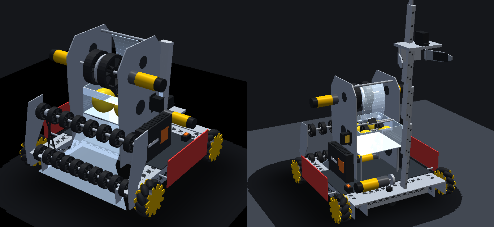

# BuzzBot, built from real parts

Generated by `tools/BuzzBotCad.java` (run `java tools/BuzzBotCad.java` from the project folder) together with
`config/robot.glb`, the 3D model, and `config/robot.model.jsonc`. BuzzBot is the example robot in
`config/robot.jsonc`; this is the robot those settings describe, put together from goBILDA and REV parts
with the makers' dimensions and weights, so that the simulator's numbers are ones a real build would have.
Weights marked *estimate* aren't published; the note says how they were worked out.

## What the simulator uses

| robot.jsonc | Value | From |
|---|---|---|
| `massLbs` | 25.4 lb (11.51 kg) | every part below |
| `cgHeightIn` | 5.05 in (128 mm) | center of gravity, lift down |
| `yawInertiaKgM2` | 0.374 kg·m² | about the center of gravity (a uniform box would be 0.396) |
| `drivetrain.trackWidthIn` | 16.29 in (413.7 mm) | Strafer drawing: 451.7 mm over the 38 mm wheels |
| `drivetrain.wheelbaseIn` | 13.23 in (336 mm) | Strafer drawing |
| `lengthIn` x `widthIn` x `heightIn` | 18.0 x 17.78 x 16.6 in | frame and wheels; intake roller at the front edge; top of the launcher plates |
| flywheel `inertiaKgM2` | 0.00048 kg·m² | steel flywheel 1651 g·cm² (goBILDA), two Gecko wheels about 1536 g·cm² each, shaft, hubs, rotors |
| lift `kit`, `massLbs` | Viper 4-stage 240 mm, 1.26 lb | 696 mm travel; claw + stages weighted by speed (210 g per stage, 258 g claw) |
| dead wheel `yIn` | -4.5 in | the parallel pod sits in the middle crossbar, inside the right rail |

Center of gravity: 13.5 mm behind, 1.2 mm right of center, 128 mm up.

## Mass by subsystem

| Subsystem | Mass |
|---|---|
| Chassis | 4270 g |
| Electronics | 1515 g |
| Intake | 1284 g |
| Hopper | 171 g |
| Launcher | 1777 g |
| Lift | 1922 g |
| Odometry | 168 g |
| Signs and hardware | 401 g |
| **Total** | **11507 g (25.4 lb)** |

## Bill of materials

| Qty | Part | SKU | Each | Total | Source |
|---|---|---|---|---|---|
| | **Chassis** | | | | |
| 2 | 1120 Series U-Channel (17 hole, 432 mm): side rails | 1120-0017-0432 | 284 g | 568 g | [gobilda.com](https://www.gobilda.com/1120-series-u-channel-17-hole-432mm-length/) |
| 2 | 1120 Series U-Channel (10 hole, 264 mm): crossbars | 1120-0010-0264 | 174 g *estimate: the 432 mm channel's 284 g scaled to 264 mm* | 348 g | [gobilda.com](https://www.gobilda.com/1120-series-u-channel-17-hole-432mm-length/) |
| 4 | 5203 Yellow Jacket motor, 19.2:1, 312 rpm: drive | 5203-2402-0019 | 437 g | 1748 g | [gobilda.com](https://www.gobilda.com/5203-series-yellow-jacket-planetary-gear-motor-19-2-1-ratio-24mm-length-8mm-rex-shaft-312-rpm-3-3-5v-encoder/) |
| 4 | GripForce mecanum wheel, 104 mm, 40A rollers | 3625-0202-0104 | 236 g | 944 g | [gobilda.com](https://www.gobilda.com/gripforce-mecanum-wheel-set-o104mm-40a-durometer-rollers/) |
| 1 | Strafer hardware: miter gears, hub-shafts, bearings, quad blocks, screws, cables | 3209-0001-0007 | 662 g *estimate: the kit's 4269 g assembled, less the channels, motors and wheels listed above* | 662 g | [gobilda.com](https://www.gobilda.com/strafer-chassis-kit-104mm-gripforce-mecanum-wheels/) |
| | **Electronics** | | | | |
| 1 | REV Control Hub | REV-31-1595 | 209 g | 209 g | [docs.revrobotics.com](https://docs.revrobotics.com/duo-control/control-system-overview/control-hub-basics) |
| 1 | REV Expansion Hub (8 motors need a second hub) | REV-31-1153 | 209 g | 209 g | [docs.revrobotics.com](https://docs.revrobotics.com/duo-control/control-system-overview/expansion-hub-basics) |
| 1 | REV 12 V Slim Battery, 3000 mAh NiMH (20 A fuse) | REV-31-1302 | 567 g | 567 g | [revrobotics.com](https://www.revrobotics.com/rev-31-1302/) |
| 1 | REV Switch Cable and Bracket | REV-31-1387 | 30 g *estimate: not listed; a switch, bracket and two XT30 leads* | 30 g | [revrobotics.com](https://www.revrobotics.com/rev-31-1387/) |
| 1 | Wiring: motor, servo, sensor, encoder and power cables |  | 250 g *estimate: about 30 cables* | 250 g |  |
| 1 | Electronics deck, 2.5 mm polycarbonate, 200 x 360 mm |  | 216 g *estimate: from its size (polycarbonate 1.20 g/cm³)* | 216 g |  |
| 1 | Battery tray, 2 mm polycarbonate |  | 34 g *estimate: from its size* | 34 g |  |
| | **Intake** | | | | |
| 1 | 5203 Yellow Jacket motor, 5.2:1, 1150 rpm: intake | 5203-2402-0005 | 399 g | 399 g | [gobilda.com](https://www.gobilda.com/5203-series-yellow-jacket-planetary-gear-motor-5-2-1-ratio-24mm-length-8mm-rex-shaft-1150-rpm-3-3-5v-encoder/) |
| 20 | GripForce Gecko wheel, 48 mm, 8 mm REX bore | 3613-4008-0048 | 16 g | 320 g | [gobilda.com](https://www.gobilda.com/gripforce-gecko-wheel-8mm-rex-bore-48mm-diameter/) |
| 2 | 8 mm REX shaft, 364 mm: roller axles | 2100 series | 142 g *estimate: steel 8 mm REX, about 0.39 g/mm* | 284 g |  |
| 2 | Intake side plate, 3 mm aluminum, pocketed |  | 70 g *estimate: from its size, 40% pocketed* | 140 g |  |
| 1 | Ramp, 2 mm polycarbonate |  | 123 g *estimate: from its size* | 123 g |  |
| 1 | GT2 belt and pulleys |  | 50 g *estimate: two pulleys and a belt* | 50 g |  |
| | **Hopper** | | | | |
| 1 | Hopper box, 1.5 mm polycarbonate, with standoffs |  | 163 g *estimate: from its size, plus 40 g of standoffs* | 163 g |  |
| 1 | REV Color Sensor V3 | REV-31-1557 | 8 g *estimate: not listed; a small circuit board in a plastic case* | 8 g | [revrobotics.com](https://www.revrobotics.com/rev-31-1557/) |
| | **Hopper and launcher** | | | | |
| 2 | 2000 Series Dual Mode Servo 25-4 (Super Speed): kicker, transfer | 2000-0025-0004 | 58 g | 116 g | [gobilda.com](https://www.gobilda.com/2000-series-dual-mode-servo-25-4-super-speed/) |
| | **Launcher** | | | | |
| 2 | 5203 Yellow Jacket motor, 1:1, 6000 rpm: flywheel | 5203-2402-0001 | 391 g | 782 g | [gobilda.com](https://www.gobilda.com/5203-series-yellow-jacket-motor-1-1-ratio-24mm-length-8mm-rex-shaft-6000-rpm-3-3-5v-encoder/) |
| 2 | GripForce Gecko wheel, 96 mm, 30A | 3613-0014-0096 | 105 g | 210 g | [gobilda.com](https://www.gobilda.com/gripforce-gecko-wheel-14mm-bore-96mm-diameter/) |
| 1 | Steel flywheel, 82 mm, 1651 g·cm² | 3628-0032-0082 | 152 g | 152 g | [gobilda.com](https://www.gobilda.com/steel-flywheel-82mm-diameter-152g-1651-g-cm/) |
| 2 | Launcher side plate, 3 mm aluminum, pocketed |  | 150 g *estimate: from its size, 50% pocketed* | 300 g |  |
| 1 | Hood, 2 mm polycarbonate, with standoffs |  | 45 g *estimate: from its size* | 45 g |  |
| 1 | Flywheel shaft, hubs and bearings |  | 105 g *estimate: 170 mm of REX shaft, two hubs, two bearings* | 105 g |  |
| 1 | Kicker paddle and transfer shaft |  | 35 g *estimate: small printed parts* | 35 g |  |
| | **Lift** | | | | |
| 1 | 5203 Yellow Jacket motor, 13.7:1, 435 rpm: lift | 5203-2402-0014 | 438 g | 438 g | [gobilda.com](https://www.gobilda.com/5203-series-yellow-jacket-planetary-gear-motor-13-7-1-ratio-24mm-length-8mm-rex-shaft-435-rpm-3-3-5v-encoder/) |
| 1 | 4 Stage Viper-Slide Kit (belt-driven, 240 mm slides), less the 4 slides | 3210-0004-0004 | 540 g | 540 g | [gobilda.com](https://www.gobilda.com/4-stage-viper-slide-kit-belt-driven-240mm-slides/) |
| 4 | Steel Viper-Slide 240 mm: outer rail (of the kit's 4) | 2500-0014-0240 | 100 g *estimate: the slide's 170 g split 100 g rail, 70 g carriage* | 400 g | [gobilda.com](https://www.gobilda.com/steel-viper-slide-10-ball-carriage-240mm-length-174mm-travel/) |
| 4 | Steel Viper-Slide 240 mm: carriage (of the kit's 4) | 2500-0014-0240 | 70 g *estimate: the slide's 170 g split 100 g rail, 70 g carriage* | 280 g | [gobilda.com](https://www.gobilda.com/steel-viper-slide-10-ball-carriage-240mm-length-174mm-travel/) |
| 1 | 2000 Series Dual Mode Servo 25-3 (Speed): claw | 2000-0025-0003 | 58 g | 58 g | [gobilda.com](https://www.gobilda.com/2000-series-dual-mode-servo-25-3-speed/) |
| 1 | Claw fingers and bracket, aluminum |  | 130 g *estimate: from their size* | 130 g |  |
| 1 | Rear mounting plate, 3 mm aluminum |  | 70 g *estimate: from its size, 40% pocketed* | 70 g |  |
| 1 | REV Magnetic Limit Switch and magnet | REV-31-1462 | 6 g *estimate: not listed* | 6 g | [revrobotics.com](https://www.revrobotics.com/rev-31-1462/) |
| | **Odometry** | | | | |
| 2 | goBILDA 4-Bar Odometry Pod (32 mm wheel) | 3110-0001-0002 | 84 g | 168 g | [gobilda.com](https://www.gobilda.com/4-bar-odometry-pod-32mm-wheel/) |
| | **Other** | | | | |
| 1 | Alliance robot signs (2) with standoffs |  | 151 g *estimate: 3 mm polycarbonate panels* | 151 g |  |
| 1 | Brackets and screws for the mechanisms |  | 250 g *estimate: about 150 screws and a dozen brackets* | 250 g |  |

## Layout

Robot frame: x forward, y left, z up, from the robot's center on the floor.

- **Chassis**: goBILDA Strafer v7. The motors lie inside the side rails and drive the wheels through steel miter gears. The crossbars sit 0.5 in ahead of center and 6 in behind it, and each holds a dead wheel.
- **Electronics**: the Control Hub and Expansion Hub stand on edge on the deck, between the launcher plates and the side rails. The battery lies between the crossbars, 28 mm off the floor, which keeps the center of gravity low.
- **Intake**: a front roller of ten 48 mm Gecko wheels picks POLLEN off the tiles. A polycarbonate ramp and a second roller take each one up into the hopper. Both rollers run off one 1150 rpm motor through a belt.
- **Hopper**: holds four POLLEN, 7 in up. The color sensor looks up through its floor at the ball the transfer takes next.
- **Launcher**: a CR-servo transfer lifts the next ball to the kicker. The kicker pushes it into two 96 mm Gecko wheels and an 82 mm steel flywheel, all on one shaft between two 6000 rpm motors. The ball goes up the back of the wheels under a polycarbonate hood and leaves 15 in up at 55°.
- **Lift**: a 4-stage Viper-Slide on the back, leaning back 6°, driven by a 435 rpm motor and a 60-tooth GT2 pulley (120 mm per turn). The claw hangs from the last stage's carriage.

Departures from a legal build, kept so BuzzBot's code and autos behave as tuned:

- The claw's grab point is 9.6 in behind center (`grippers` in robot.jsonc), so the claw sticks out about 2.5 in behind the 18 in starting box. A real BuzzBot would fold the claw in at the start.
- The REV battery's 20 A fuse would blow if all eight motors pulled hard at once. The simulator doesn't model fuses, only the battery's voltage sag.

Model: 67 parts, 31844 triangles, 944 KB.
